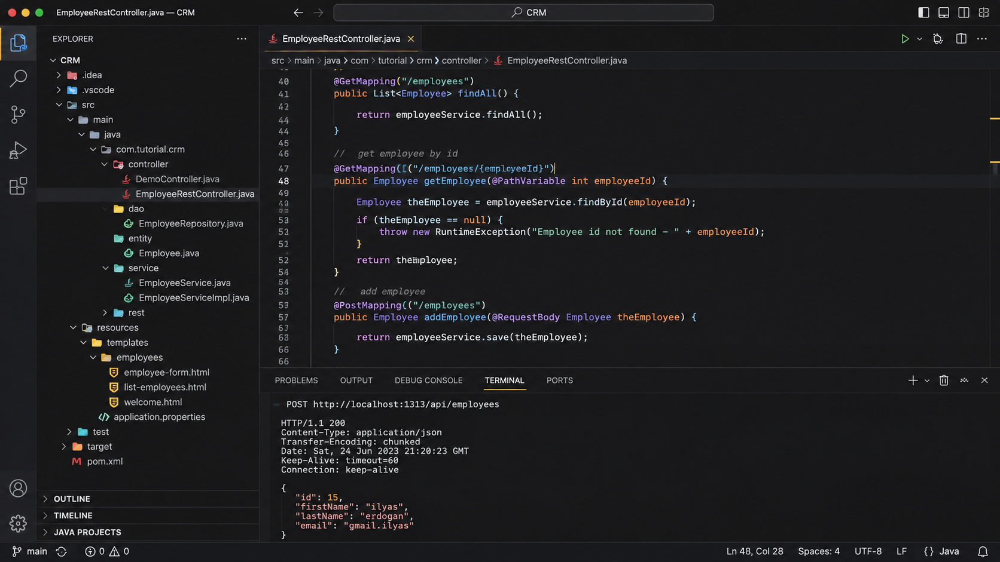

# Noctyra

**A darker space for brighter ideas.**

Noctyra is a minimal, carefully balanced dark theme for Visual Studio Code, designed to keep your attention where it belongs: on your code.

With deep charcoal backgrounds, subtle contrasts, and thoughtfully selected syntax colors, Noctyra creates a comfortable coding environment without unnecessary visual distractions.

## Preview

## Features

- **Deep charcoal interface** — A consistent dark palette across the editor, sidebar, tabs, panels, and terminal.
- **Balanced syntax highlighting** — Distinct colors for keywords, strings, functions, numbers, and comments.
- **Semantic highlighting** — Enhanced code readability through language-aware token coloring.
- **Subtle visual hierarchy** — Carefully selected contrasts that help important elements stand out.
- **Distraction-free design** — Minimal visual noise for a focused development experience.
- **Lightweight** — A native VS Code color theme with no runtime dependencies.

## Color Palette

| Element | Color |
|---|---|
| Background | `#1A1A1A` |
| Foreground | `#A9B7C6` |
| Keywords | `#CC7832` |
| Strings | `#6A8759` |
| Functions | `#FFC66D` |
| Numbers | `#6897BB` |
| Comments | `#606366` |

## Installation

1. Open **Extensions** in Visual Studio Code.
2. Search for **Noctyra**.
3. Select **Install**.
4. Open **Preferences → Color Theme** and choose **Noctyra**.

## Feedback & Contributions

Have an idea for improving Noctyra or noticed an inconsistency in the highlighting?

Suggestions, bug reports, and contributions are welcome through the project's GitHub repository.

## License

Noctyra is open source and distributed under the MIT License.

---

**Noctyra** — Made for developers who prefer the dark.
